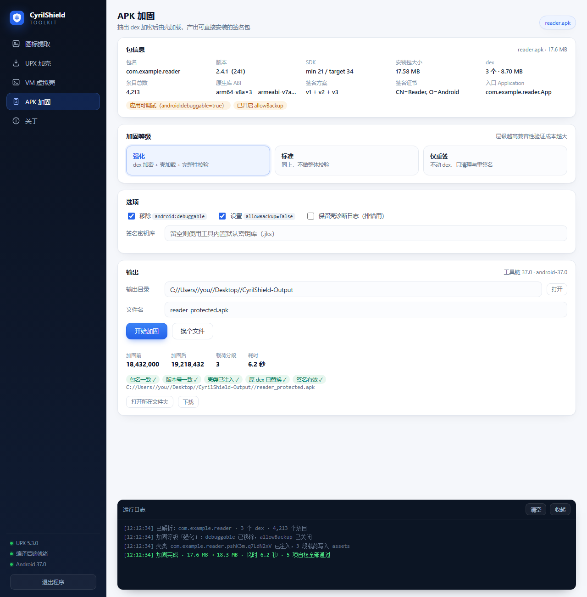

# CyrilShield

Windows 本地的 exe / apk 保护工具：**图标提取 · UPX 加壳 · VM 虚拟壳 · APK 加固**。

界面是本地网页（`127.0.0.1` + 随机端口 + 随机令牌），用 Edge / Chrome 开成无边框窗口，全程不联网、不上传任何文件。



## 功能

| 功能 | 输入 | 输出 | 说明 |
|---|---|---|---|
| **图标提取** | `.exe` `.dll` `.scr` `.cpl` `.ocx` | ICO / PNG | 从资源段直接解析，按尺寸和色深分组导出，支持 PNG 压缩图标与 AND 掩码合成 |
| **UPX 加壳** | `.exe` | 压缩后的 exe | 内置 UPX 5.3.0，支持 1–9 级 / `--best` / `--brute` / LZMA，可压缩图标资源、保留重定位 |
| **VM 虚拟壳** | `.exe` | 自带解释器的 exe | 把 x86 指令翻译成自定义字节码，由内置虚拟机执行；每次构建随机化指令编号、字段排列、模块符号名 |
| **APK 加固** | `.apk` `.xapk` `.apks` | 已重签名 apk | 抽出全部 `classes*.dex` 加密后作为 assets 回填，壳 Application 在运行时解密并注入类加载器 |

## 运行

```bash
python main.py
```

需要 Python 3.10+。窗口会自动打开；加 `--no-browser` 只起服务，`--port=8765` 固定端口。

依赖按功能分档，缺了只会降级对应能力，不会影响其他功能：

```bash
pip install -r requirements.txt   # Pillow（PNG 导出）+ PyInstaller（VM 壳后端）
```

**APK 加固需要的外部工具**（程序自动探测，顺序为 `ANDROID_HOME` → `ANDROID_SDK_ROOT` → `%LOCALAPPDATA%\Android\Sdk` → `~/Android/Sdk` → `C:\Android\Sdk`）：

- JDK 11+ 的 `javac` / `keytool` / `java`
- Android SDK `build-tools` 的 `d8` / `apksigner` / `zipalign`
- `platforms\android-XX\android.jar`

缺任何一项时，侧栏会显示「Android 工具链缺失」，加固按钮会直接报错说明缺什么。

## 打包成独立 EXE

```bash
python -m PyInstaller --onefile --windowed --noupx --name CyrilShield ^
  --icon "assets/app.ico" ^
  --add-binary "tools/upx.exe;tools" ^
  --add-data "cyrilshield/web;cyrilshield/web" ^
  --add-data "assets/app.ico;assets" ^
  --hidden-import=PIL.Image --hidden-import=PIL.ImageTk main.py
```

也可以直接双击 `重建EXE.bat`。产物在 `dist/`，约 28 MB，**单文件**：图标提取和 UPX 加壳不需要目标机器装任何东西。

## 便携版（APK 加固也不需要装 SDK）

```bash
python build_portable.py            # 单文件，约 93 MB
python build_portable.py --onedir   # 目录版，启动更快
python build_portable.py --refresh  # 重新从本机 JDK / SDK 生成 toolchain/
```

`toolchain/` 由本机 JDK 用 `jlink` 裁出精简运行时（`java.base / jdk.compiler / jdk.zipfs / java.logging / java.xml`），再拷入 build-tools 的四个可执行体和 `android.jar`，共约 104 MB。程序优先使用自带的这套工具链，找不到才回落到系统安装。

`toolchain/` 不入库（见 `.gitignore`），需要时用 `--refresh` 现生成。

## 自检

```bash
python selftest.py                # 用系统 notepad.exe 作样本
python selftest.py path\to.apk    # 额外跑 APK 相关检查
```

覆盖 PE 解析、图标提取、UPX 打包/测试/脱壳、VM 字节码与多态随机化、载荷容器封装、AXML 往返一致性、APK 结构解析与加固构建。缺少对应环境时该项标记 `SKIP`，不会假装通过。

## 项目结构

```
main.py                启动入口
selftest.py            自检脚本
build_portable.py      便携版构建（生成 toolchain/ 并打包）
cyrilshield/
  pe.py                PE 头 / 节区 / 资源目录解析（纯 Python，不依赖 Win32 API）
  upx.py               内置 UPX 的定位与调用
  vmgen.py             VM 字节码生成与虚拟壳编译
  apk.py               APK 解析、加固、重打包签名
  axml.py              二进制 AndroidManifest.xml 读写
  _stream.py           HMAC-SHA256 计数器流加密与载荷容器
  server.py            本地 HTTP 服务与接口
  web/                 界面（原生 HTML/CSS/JS，无框架）
tools/upx.exe          内置 UPX（GPL，见 tools/UPX-LICENSE.txt）
assets/app.ico         程序图标
tests/sample.apk       自测用样本
```

## APK 加固做了什么

1. 解析二进制 `AndroidManifest.xml`，把 `android:name` 指向注入的壳类（随机包名 + 随机类名），移除 `android:debuggable`，可选关闭 `allowBackup`
2. 抽出全部 `classes*.dex`，逐段用 HMAC-SHA256 计数器流加密，写入随机命名的 `assets/xx/yy.dat`
3. 生成壳 Application 并编译成 dex：`attachBaseContext` 阶段解密载荷，做整体 SHA-256 校验，注册到类加载器
4. 用 `Instrumentation.newApplication` 重建你原来的 Application 并接管框架侧实例，所以 `getApplication()` 返回的仍是你的类
5. `zipalign` 4 字节对齐后重新签名（`minSdk < 24` 时自动补 v1 签名）

几个刻意为之的细节：

- **载荷没有固定文件头**：格式是 `[密文 | nonce(16) | tag(8)]`，密文从第 0 字节开始，扫描器拿不到 `PS` 之类的魔数特征
- **密钥分片**：主密钥由八组 `int[]` 常量按位异或重建，单看任一组都是随机数；每段载荷的子密钥用两级 HMAC 派生，兄弟段之间无法互相推导
- **类名不落明文**：真实 Application 类名与期望摘要都以异或掩码的 `byte[]` 形式存在，运行时解码，dex 字符串表里查不到
- **签名块名随机**：`apksigner` 用密钥别名命名 v1 签名块，默认密钥库的别名是随机生成的，产物里不会出现固定文件名
- **v4 签名关闭**：`--v4-signing-enabled false`，避免额外吐一个没人用的 `.idsig` 旁路文件

首次使用会在 `%LOCALAPPDATA%\CyrilShield\` 生成自签名密钥库（口令 `cyrilshield2026`），足够自测和内部使用。**正式发布请换用你自己的密钥库**，并在界面上填写路径与口令。

## 适用范围

这个工具做的是**对自己程序的保护**：加密、完整性校验、反篡改、类名与路径混淆。

它**不包含**也不会实现反调试、反沙箱、杀软对抗、AMSI 绕过、进程注入之类的对抗性手段。加密和混淆能提高静态分析的入门门槛，但不会让程序「免杀」，也不承诺躲过任何检测。

## 注意

- **加壳会使原签名失效。** 本工具会用自带密钥重新签名，安装前请先卸载旧版本（签名不同无法覆盖升级）
- **抽取式加固有固有特征**：`classes.dex` 被抽空、真正代码藏在 assets 里，这类模式本身是可检测的，部分应用商店和加固检测会报警
- 处理第三方程序可能违反其许可协议和相关法律，请只用于你拥有合法权利的程序

## 许可

代码可自由使用和修改。内置的 `tools/upx.exe` 遵循 GPL v2+，许可证见 `tools/UPX-LICENSE.txt`。
